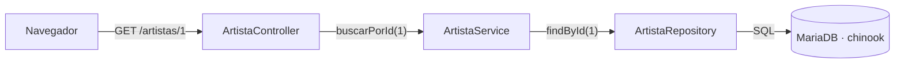
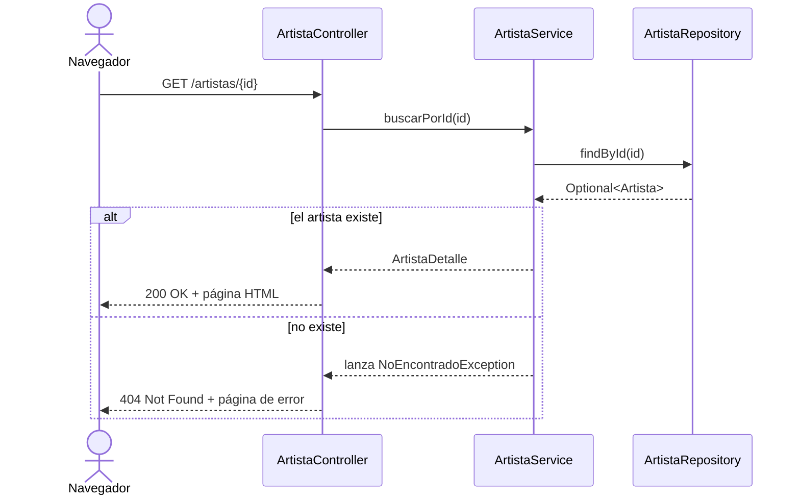

# chinook-spring

Tienda de música Chinook en el navegador: el modelo de la PG3 de la UT2 (entidades y repositorios de Spring Data JPA) con controladores que escriben páginas HTML sencillas, servicios con interfaz e implementación, DTO, manejo de errores y pruebas sin base de datos. Prácticas guiadas 3.1 y 3.2 de DWES (UT3).

## Cómo arrancar

1. Requisitos: Java 21, IntelliJ IDEA y MariaDB con la base de datos Chinook cargada (`chinook` en `localhost:3306`, usuario `root` sin contraseña).
2. File › Open y elige la carpeta que contiene `pom.xml`. Espera a que Maven descargue las dependencias.
3. Ejecuta `ChinookApplication`. En la consola debe aparecer `Tomcat started on port 8080`.
4. Abre `http://localhost:8080` en el navegador.

## Qué hace

| Método | Ruta | Qué muestra |
|---|---|---|
| GET | `/` y `/inicio` | Portada con enlaces y contador de visitas |
| GET | `/generos` | Géneros con su número de pistas |
| GET | `/artistas` | Redirige (302) a `/artistas/buscar` |
| GET | `/artistas/buscar?texto=` | Buscador de artistas |
| GET | `/artistas/{id}` | Ficha del artista con sus álbumes (404 si no existe) |
| GET | `/albumes/{id}` | Ficha del álbum con sus pistas (404 si no existe) |
| GET | `/hola` y `/hola-html` | Primeras pruebas del controlador |

Cualquier otra ruta muestra la página `static/error/404.html`; un id que no es un número (`/artistas/abc`) da 400.

### Capas

### Ficha de un artista, con el camino de error

## Cómo se prueba

Las pruebas no necesitan base de datos ni servidor: clic derecho en `src/test/java` › *Run 'All Tests'*.

- `ArtistaServiceImplTest`: el servicio con los repositorios simulados con Mockito (ficha con álbumes y artista inexistente).
- `ArtistaControllerTest`: el controlador con `@WebMvcTest`, `MockMvc` y el servicio simulado con `@MockitoBean` (200, 404, 400, 405 y escape de los textos).

## Decisiones y limitaciones

- Los controladores escriben el HTML con cadenas de Java y la clase `Html` (página común y escape). En la UT4 lo sustituyen las plantillas de Thymeleaf.
- `spring.jpa.open-in-view=false`: los servicios devuelven DTO (`record`) construidos dentro de `@Transactional(readOnly = true)`; los controladores no reciben entidades.
- Los errores se traducen a códigos HTTP en un solo sitio, `ManejadorErrores` (`@ControllerAdvice`).
- Solo hay consultas (GET): crear, modificar y borrar llegan en la UT4.
- Código sin lambdas.

## Uso de IA

Indica aquí si has usado alguna herramienta de IA, para qué y qué parte del código has escrito o revisado tú.